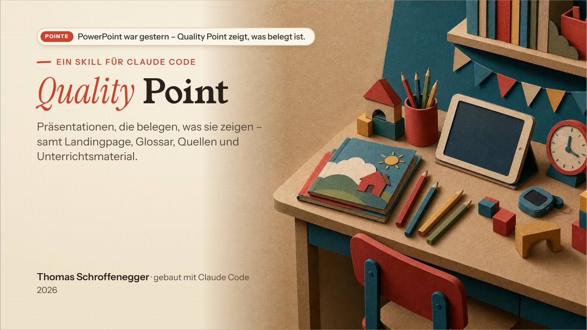
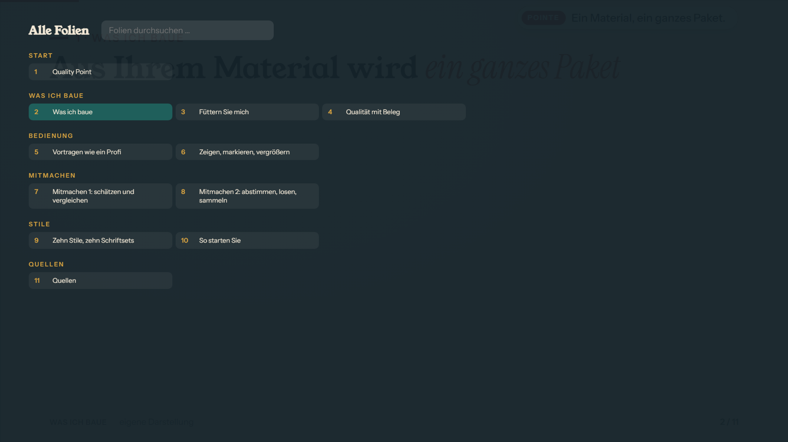
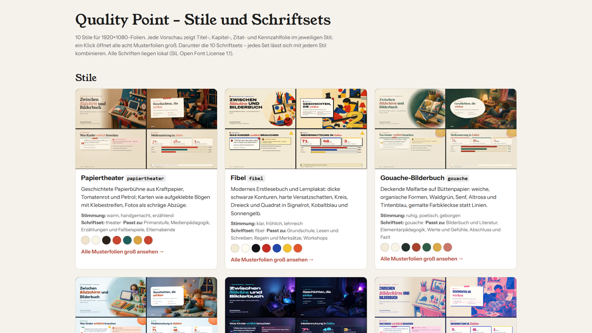
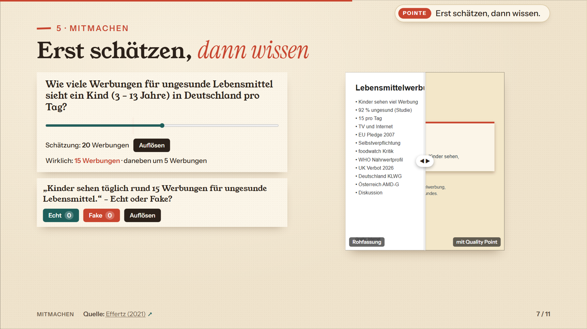

# Quality Point

**Präsentationen, die man nicht nur zeigt, sondern belegen kann.** Ein Skill für Claude Code, der aus Thema oder Vorlage eine geprüfte HTML-Präsentation baut – mit Referentenansicht, Quellen, Glossar und auf Wunsch Unterrichtsmaterial. Die Dateiendung *.qptx* gibt es übrigens nicht. Die Qualität schon.

*[English version below](#english)*


<!-- Platzhalter: Screenshots folgen unter docs/bilder/ -->

---

## Was Quality Point macht

Du sagst Claude Code, worum es geht und womit gearbeitet werden soll. Quality Point fragt sauber nacheinander nach Zielgruppe, Material, Umfang, Stil und gewünschten Bausteinen, schlägt eine Gliederung vor und baut nach deiner Freigabe selbstständig:

- **Präsentation** als eine HTML-Datei – offline, ohne PowerPoint, in jedem aktuellen Browser
- **Referentenansicht** mit Notizen, Timer und Zwei-Bildschirm-Modus
- **Quellenverzeichnis** (APA 7) mit Sprung von der Folie zur Quelle und zurück
- **Glossar**, auf den Folien anklickbar
- auf Wunsch: **Landingpage**, **Fachartikel** (über [claude-research](https://github.com/harubert/claude-research)), **Lehrplan-Bezug**, **Unterrichtsmaterial als Word** (Feinziele, didaktische Analyse nach Klafki, Lösungen mit Begründung), **Werkstatt-Aufträge**, **Video-Inhaltsangaben**, **Interaktionsbausteine**

Der Anspruch steckt im Namen: Jede Zahl braucht eine Quelle und eine Bezugsgruppe, jedes Bild eine Herkunft, jede Folie muss die automatische Layoutprüfung bestehen. Was nicht belegt ist, wird gekennzeichnet oder weggelassen.

| | |
|---|---|
|  |  |
| Referentenansicht (`P`) | Übersicht mit Suche (`O`) |
|  |  |
| Stilauswahl: 10 Stile × 10 Schriftsets | Interaktionsbaustein „Echt oder Fake“ |

## Der Inhaltsschalter

Wer eine bestehende Präsentation mitbringt, entscheidet, wie frei Claude damit umgehen darf:

| Modus | Bedeutung |
|---|---|
| **Exakt und vollständig nach Vorlage** | Alle Texte, Bilder, Videos, Links und Fragen bleiben Mindestumfang, nur die Gestaltung ist neu. |
| **Vorlage + eigene Regie** | Vorlage vollständig, Claude ergänzt Forschung, Beispiele, Übungen. |
| **Freie Regie** | Claude entwirft neu, die Vorlage ist Steinbruch. |
| **Anderes Schema** | z. B. Einstieg – Erarbeitung – Sicherung, Vorlesung, Workshop, Flipped Classroom, Pecha Kucha, Keynote-Talk. |

## Schnellstart

### Voraussetzungen

- [Claude Code](https://claude.com/claude-code) (CLI oder Erweiterung für VS Code)
- Python 3.10 oder neuer
- Python-Pakete: `pip install python-docx Pillow python-pptx` – optional `PyMuPDF` (PDF-Vorlagen)
- Microsoft Edge oder Google Chrome (für Layoutprüfung und Screenshots, headless)
- optional: ein API-Schlüssel für generierte Bilder (OpenAI, Google Gemini/Imagen, fal.ai, Stability, Replicate) – **nur als Umgebungsvariable**

### Installation

```bash
git clone https://github.com/harubert/quality_point
```

Dann eine der beiden Varianten:

- **Als Projekt öffnen:** den Ordner `quality_point` in Claude Code öffnen. Der Skill unter `.claude/skills/quality-point/` ist dort sofort verfügbar.
- **Global installieren:** den Ordner `.claude/skills/quality-point` nach `~/.claude/skills/quality-point` kopieren (Windows: `%USERPROFILE%\.claude\skills\quality-point`). Damit der Skill die Engine findet, die Umgebungsvariable `QP_HOME` auf den geklonten Ordner setzen oder ihn als `~/quality_point` ablegen. Findet der Skill keine Engine, bietet er an, das Repository zu klonen.

### Beispiel-Prompt

> Ich halte im November eine 90-minütige Fortbildung „KI im Deutschunterricht der Sekundarstufe“ für Lehrer*innen. Hier ist meine alte PowerPoint (`vorlage/ki_deutsch.pptx`). Mach daraus mit Quality Point eine neue Präsentation – Vorlage vollständig, aber gern mit aktueller Forschung ergänzt – plus Glossar, Quellen und drei Arbeitsblätter.

Claude stellt dann die offenen Fragen, öffnet die Stilauswahl, zeigt die Gliederung zur Freigabe und baut anschließend durch.

## Ordnerstruktur

```
quality_point/
├── .claude/skills/quality-point/SKILL.md   ← der Skill (Ablauf für Claude)
├── engine/                        ← Bau-, Prüf- und Veröffentlichungswerkzeuge
│   ├── quality_point.beispiel.json         ← Vorlage für die Projektkonfiguration
│   ├── konfig.py                  ← Standardwerte und gemeinsame Pfade
│   ├── neues_projekt.py           ← legt ein Projekt an
│   ├── build.py · pruefen.py · deploy.py
│   ├── FOLIEN.md · TOKENS.md      ← Folientypen/Bausteine · Design-Variablen
│   ├── src/                       ← Hülle, Engine (JS/CSS), Interaktionen, vendor/qrcode.js
│   ├── fonts/                     ← lokale Schriften (OFL)
│   └── werkzeuge/                 ← Quellen, Seiten, Materialien, Screenshots, Bilder
├── styles/                        ← 10 Stile, 10 Schriftsets, index.html (Auswahl)
├── demo/                          ← Beispielprojekte
└── docs/                          ← ABLAUF.md · REGELN.md · FEATURES.md · bilder/
```

Ein **Projekt** liegt außerhalb des Quality-Point-Ordners und enthält vor allem `quality_point.json`, `src/slides/`, `img/` und die gebauten Seiten. Alle Skripte werden mit dem Projektordner aufgerufen: `python engine/build.py <projektordner>`.

## Dokumentation

- [docs/ABLAUF.md](docs/ABLAUF.md) – der Aufnahme-Dialog im Detail, Bildanbieter, Veröffentlichung
- [docs/REGELN.md](docs/REGELN.md) – Qualitätsregeln: Belege, Bildrechte, Datenschutz, Typografie, Didaktik, Barrierefreiheit
- [docs/FEATURES.md](docs/FEATURES.md) – alle Funktionen und Tasten der fertigen Präsentation
- `engine/FOLIEN.md` – Folientypen und Bausteine für Autor*innen

## Funktionen in Kürze

Steuerleiste mit Teilschritt-Anzeige · Referentenansicht (`P`) · Zwei-Bildschirm-Modus (`S`, Chrome/Edge) · große Folie im Notizfenster (`V`) · Schwarzbild (`B`/`.`) · Stifte (`Z`) · Spotlight (`X`) · Laser (`L`) · Bildansicht mit Lupe · Glossar (`G`) · Quellenlinks mit Rücksprung · Sprungkarten · Übersicht mit Suche (`O`) · Pointen-Banner (`K`) · Zähler · Video-Inhaltsangaben und lokale Videokopien · Foliensprung per Adresse (`#47.2`) oder Ziffern + `Enter` · Interaktionsbausteine (Schätzregler, Vorher-nachher, Ausschnitt, Echt/Fake, Zuordnen, Timer, Zufallsrad, Wortwolke, Karteikarte, QR, Ampel) · Landingpage, Glossar-, Lehrplan- und Quellenseite · Word-Materialien · Bilder-Herkunftsübersicht · Prüf- und Deploy-Werkzeuge mit Sperrliste.

Keine Google Fonts, keine CDNs, keine Tracker: Alles läuft lokal.

## Demos

- `demo/selbstvorstellung/` – kurze Selbstvorstellung des Autors, zeigt die Bausteine im Kleinen
- `demo/beispiel-medienpaedagogik/` – Auszug aus einer Lehrveranstaltung „Medienpädagogik in der Primarstufe“ mit Glossar, Quellen und Unterrichtsmaterial

Beide Demos stammen vom Autor.

## Danksagungen

- [claude-research](https://github.com/harubert/claude-research) – das Forschungs-Template desselben Autors (MIT), liefert auf Wunsch Fachartikel und geprüfte Quellen
- [QR Code Generator for JavaScript](https://github.com/kazuhikoarase/qrcode-generator) von Kazuhiko Arase (MIT)
- Schriften unter der SIL Open Font License 1.1 (u. a. Young Serif, Instrument Sans, Instrument Serif, Source Serif 4), lokal eingebunden
- gebaut mit [Claude Code](https://claude.com/claude-code) (Anthropic)

## Lizenz

MIT © 2026 Thomas Schroffenegger – siehe [LICENSE](LICENSE).
Mit der ausgesprochen erfreulichen Hilfe von Claude Code (Anthropic) entstanden.

---

<a id="english"></a>

# Quality Point (English)

**Presentations you can not only show, but back up.** A Claude Code skill that turns a topic or an existing slide deck into a verified HTML presentation – with presenter view, references, glossary and, if you like, teaching materials. The *.qptx* file extension doesn't exist, by the way. The quality does.

## What Quality Point does

You tell Claude Code what the talk is about and what to work with. Quality Point asks, one step at a time, about audience, material, scope, style and the components you want, proposes an outline and – once you approve it – builds everything on its own:

- **Presentation** as a single HTML file – offline, no PowerPoint, any current browser
- **Presenter view** with notes, timer and dual-screen mode
- **Reference list** (APA 7) with jump from slide to source and back
- **Glossary**, clickable on the slides
- optionally: **landing page**, **scholarly article** (via [claude-research](https://github.com/harubert/claude-research)), **curriculum links**, **teaching materials as Word files** (learning objectives, didactic analysis after Klafki, answer keys with reasoning), **workshop tasks**, **video summaries**, **interactive widgets**

The name is the promise: every figure needs a source and a reference group, every image a provenance, every slide must pass the automated layout check. Anything that cannot be verified is labelled or left out.

## The content switch

If you bring an existing deck, you decide how freely Claude may treat it:

| Mode | Meaning |
|---|---|
| **Exact and complete** | All texts, images, videos, links and questions of the original are the minimum; only the design is new. |
| **Original + own direction** | Original complete; Claude adds research, examples, exercises. |
| **Free direction** | Claude designs from scratch; the original is a quarry. |
| **Different scheme** | e.g. introduction – elaboration – consolidation, lecture, workshop, flipped classroom, Pecha Kucha, keynote talk. |

## Quick start

### Requirements

- [Claude Code](https://claude.com/claude-code) (CLI or VS Code extension)
- Python 3.10 or newer
- Python packages: `pip install python-docx Pillow python-pptx` – optionally `PyMuPDF` (PDF sources)
- Microsoft Edge or Google Chrome (headless, for layout checks and screenshots)
- optional: an API key for generated images (OpenAI, Google Gemini/Imagen, fal.ai, Stability, Replicate) – **environment variable only**

### Installation

```bash
git clone https://github.com/harubert/quality_point
```

Then either:

- **Open as a project:** open the `quality_point` folder in Claude Code. The skill in `.claude/skills/quality-point/` is available right away.
- **Install globally:** copy `.claude/skills/quality-point` to `~/.claude/skills/quality-point` (Windows: `%USERPROFILE%\.claude\skills\quality-point`). So the skill can find the engine, set the environment variable `QP_HOME` to the cloned folder or place it at `~/quality_point`. If no engine is found, the skill offers to clone the repository.

### Example prompt

> In November I'm giving a 90-minute in-service training "AI in secondary-school language teaching" for teachers. Here is my old PowerPoint (`vorlage/ai_language.pptx`). Use Quality Point to turn it into a new presentation – keep everything from the original, but feel free to add current research – plus glossary, references and three worksheets.

Claude then asks the open questions, opens the style picker, shows the outline for approval and builds the rest.

## Folder structure

```
quality_point/
├── .claude/skills/quality-point/SKILL.md   ← the skill (workflow for Claude)
├── engine/                        ← build, check and publish tools
│   ├── quality_point.beispiel.json         ← template for the project configuration
│   ├── konfig.py                  ← defaults and shared paths
│   ├── neues_projekt.py           ← creates a project
│   ├── build.py · pruefen.py · deploy.py
│   ├── FOLIEN.md · TOKENS.md      ← slide types/components · design tokens
│   ├── src/                       ← shell, engine (JS/CSS), widgets, vendor/qrcode.js
│   ├── fonts/                     ← local fonts (OFL)
│   └── werkzeuge/                 ← references, pages, materials, screenshots, images
├── styles/                        ← 10 styles, 10 font sets, index.html (picker)
├── demo/                          ← example projects
└── docs/                          ← ABLAUF.md · REGELN.md · FEATURES.md · bilder/
```

A **project** lives outside the quality_point folder and mainly contains `quality_point.json`, `src/slides/`, `img/` and the built pages. Every script takes the project folder as argument: `python engine/build.py <project-folder>`.

The documentation in `docs/` and `engine/` is written in German; the presentations themselves can be built in German or English (`"sprache": "en"` in `quality_point.json`).

## Features at a glance

Control bar with sub-step indicator · presenter view (`P`) · dual-screen mode (`S`, Chrome/Edge on Windows and macOS via the Window Management API) · large slide in the notes window (`V`) · black screen with hint (`B`/`.`) · pens: marker, highlighter, emoji stamp, eraser (`Z`) · spotlight (`X`) · laser (`L`) · image viewer with magnifier · glossary popover (`G`) · source links with return jump · jump cards · overview with search (`O`) · punchline banner (`K`) · animated counters · video summaries and local video copies (presenter machine only) · slide address (`#47.2`) or digits + `Enter` · interactive widgets (estimate slider, before/after, reveal crop, real or fake, sort, timer, wheel of names, word cloud, flash card, QR code, traffic light) · landing page, glossary, curriculum and reference pages · Word materials · image provenance overview · check and deploy tools with a blocklist for keys, local paths and CDNs.

No Google Fonts, no CDNs, no trackers: everything runs locally.

## Demos

- `demo/selbstvorstellung/` – a short self-introduction by the author, showing the components in miniature
- `demo/beispiel-medienpaedagogik/` – excerpt from a university course "Media education in primary school" with glossary, references and teaching materials

Both demos are by the author.

## Credits

- [claude-research](https://github.com/harubert/claude-research) – the author's research template (MIT), optionally supplies the article and verified sources
- [QR Code Generator for JavaScript](https://github.com/kazuhikoarase/qrcode-generator) by Kazuhiko Arase (MIT)
- Fonts under the SIL Open Font License 1.1 (including Young Serif, Instrument Sans, Instrument Serif, Source Serif 4), embedded locally
- built with [Claude Code](https://claude.com/claude-code) (Anthropic)

## License

MIT © 2026 Thomas Schroffenegger – see [LICENSE](LICENSE).
Brought to life with the rather delightful help of Claude Code (Anthropic).
